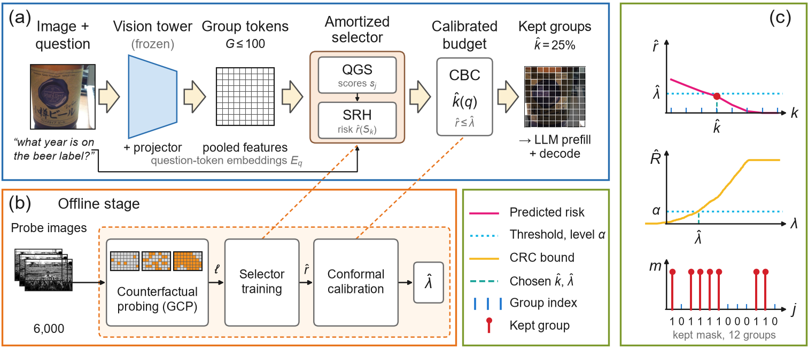

<div align="center">

# Q-EASE

### Calibrated Evidence Sufficiency for Efficient Vision-Language Models

*Question-conditioned visual-token pruning with a conformal bound on how often pruning changes the model's answer.*




</div>

<br>

Visual tokens dominate the prefill cost of vision-language models (VLMs). Existing pruners rank tokens by attention or similarity, use one budget for every question, and say nothing about how often pruning changes the answer.
**Q-EASE** treats pruning as *evidence sufficiency*: a kept subset of visual tokens is sufficient for a question if the pruned model's answer distribution stays close to the full model's.

- **Offline**, a frozen VLM is probed with counterfactual group masks and the divergence of its answer distribution is recorded (**GCP**).
- A **4M-parameter selector** amortizes these labels: a question-guided group scorer (**QGS**) ranks groups and a set-level risk head (**SRH**) predicts the risk of any kept set.
- A **calibrated budget controller** (**CBC**) uses conformal risk control to pick, per question, the smallest budget whose predicted risk stays under a threshold, with a finite-sample bound on the answer-disagreement rate.

Pruning happens before LLM prefill, positions are preserved, and no change to the VLM is needed.

## Results at a glance

Qwen2-VL-2B, seven VQA benchmarks, 1,795 held-out test questions. All numbers come from the paper's analysis scripts; intervals are 95% bootstrap intervals.

| | Random | FastV | VisionZip | **Q-EASE** |
|---|:---:|:---:|:---:|:---:|
| Mean JS to the full model at 25% of the tokens (lower is better) | 0.161 | 0.119 | 0.097 | **0.073** |

| Calibrated budget (answer-flip loss, target risk 0.10) | Kept tokens | Realized risk |
|---|:---:|:---:|
| Best calibrated fixed budget | 75.2% | within target |
| **Q-EASE adaptive** | **62.4%** | 0.089 (Wilson 95% interval 0.076 to 0.103) |

| Measured on a T4 (batch size 1) at 25% of the groups | Unpruned | Pruned |
|---|:---:|:---:|
| Prefill FLOPs | 883 G | 305 G (2.9x) |
| Prefill time | 85.2 ms | 40.2 ms (2.1x) |
| End-to-end latency (selector: 2.5 ms) | 240.7 ms | 198.2 ms (1.21x) |

Decoded answers keep 85.7% of the unpruned accuracy at 25% of the tokens on held-out questions. The advantage over VisionZip is within noise, and on the official POPE, TextVQA, VQAv2 and A-OKVQA splits attention-based pruning is as accurate as Q-EASE. The conformal guarantee is marginal: it holds on average over test questions, not within every dataset. The paper reports these limits in full.

## Repository layout

```
qease/
  config.py            default configuration (every key can be overridden)
  state.py             run-time state shared by the modules (paths, models, selectors, thresholds)
  pipeline.py          stage driver: pool -> load -> phase0 -> probe -> train -> eval -> crc -> gen -> latency -> analyze
  cli.py               python -m qease ...
  data.py              data pool: seven VQA datasets, image cache, image-level splits
  vlm/                 frozen-VLM wrapper (hook-based runner, attention spy, FastV / VisionZip / SparseVLM ports)
  selection.py         probe masks, trivial baselines, nested kept sets, compute-matched evaluation
  probing.py           group-level counterfactual probing (offline labels)
  phase0.py            headroom pilot with an oracle selector
  selector.py          QGS + SRH and their training
  evaluation.py        every selection method on the calibration and test splits
  crc.py               conformal risk control: envelope loss, thresholds, fixed / adaptive / per-dataset policies
  stats.py             bootstrap, paired tests, Holm correction, Wilson intervals
  generation.py        downstream accuracy with physically pruned decoding
  latency.py           latency, FLOPs and memory
  analysis/            every table and figure of the paper (CSV, LaTeX and vector PDF)
  extra/               extra experiments: trained baselines, question swap, accuracy, standard benchmarks, second model
legacy/qease_kaggle.py single-file version of the pipeline that produced the paper's first run (kept for provenance)
assets/                figures used in this README
tests/                 unit tests of the answer metrics
```

## Installation

```bash
git clone https://github.com/abidhasanrafi/qease.git
cd qease
pip install -e .
```

Python 3.10 or newer, PyTorch 2.x and `transformers>=4.45`. A GPU with fp16 support is required for probing and evaluation; the reference setup is Kaggle with 2 x T4 (16 GB each). Internet access is needed to download the datasets and the VLM from the Hugging Face Hub (set `HF_TOKEN` for faster downloads).

## Quick start

Run the full pipeline for Qwen2-VL-2B:

```bash
python -m qease --stages pool load phase0 probe train eval crc analyze
```

or from Python (for example in a Kaggle notebook):

```python
from qease.pipeline import run

run(stages=["pool", "load", "probe", "train", "eval", "crc", "analyze"])
```

Every stage is idempotent and writes to disk, so after an interruption you re-run the same command and finished work is skipped.

| Stage | What it does | Notes |
|---|---|---|
| `pool` | downloads and caches 11.5k image-question pairs from VQAv2, GQA, A-OKVQA, TextVQA, DocVQA, VSR, CLEVR | splits are made by image hash |
| `load` | loads the VLM on every GPU, runs sanity checks and the self-tests of the FastV, VisionZip and SparseVLM ports | a baseline is only used if its self-test passes |
| `phase0` | headroom pilot: oracle group-removal ranking against cheap baselines | 120 questions |
| `probe` | counterfactual probing, 24 masks per image | about 83 min for 6,000 images on 2 x T4 |
| `train` | trains the selector (full and no-question variants) | about 5 min |
| `eval` | evaluates every method on the calibration and test splits | |
| `crc` | calibrates the conformal thresholds | |
| `gen` | downstream accuracy with physically pruned decoding | |
| `latency` | measured latency, FLOPs and memory | |
| `analyze` | writes every table and figure of the paper | |

Override any configuration key from the command line (values are Python literals):

```bash
python -m qease --stages pool load probe train eval crc analyze \
    --set MODEL_ID=Qwen/Qwen2.5-VL-3B-Instruct PROBE_TOTAL=3000 CAL_N=600 TEST_N=800 SPARSEVLM=False
```

The defaults and their comments are in [`qease/config.py`](qease/config.py).

## Outputs

Everything is written under `<base-dir>/<model>/` (default `/kaggle/working/qease` on Kaggle, `./qease_out` elsewhere; change it with `--base-dir`):

```
pool/                      shared data pool (images and metadata)
<model>/probe/             probe shards (masks and labels)
<model>/ckpt/              trained selectors
<model>/eval/              per-question evaluation records
<model>/results/tables/    CSV (+ LaTeX) tables, including lambdas.json with the calibrated thresholds
<model>/results/figures/   vector PDF + PNG figures
<model>/results/figdata/   the exact tidy data behind every figure
```

## Extra experiments

`qease.extra` closes the gaps a reviewer would point at. It re-uses the first run's selectors, thresholds and evaluation records.

```bash
python -m qease.extra --set RUN_MODEL2=False BENCH_N_PER_DS=80 STD_N=80
```

| Block | Question it answers |
|---|---|
| Trained baselines | is the gain due to the counterfactual labels or to training in general? (attention-distilled, MLP and shuffled-label selectors) |
| Question swap | does the selected set depend on the question? |
| Downstream accuracy | official VQA accuracy, ANLS and exact match on held-out questions |
| Standard benchmarks | the same on official POPE, TextVQA, VQAv2 and A-OKVQA splits that are not in the training pool |
| Second model | probing, training and calibration for Qwen2.5-VL-3B with a compact protocol |

The options are in [`qease/extra/config.py`](qease/extra/config.py). The trained-baseline block needs the probe shards of the first run.

## Adding your own pruning method

Register a function that returns one importance score per visual token. It is then evaluated with the same pre-LLM pruning protocol, budgets and metrics as every other method.

```python
from qease import state

# fn(runner, ctx) -> 1-D tensor of per-visual-token importance (higher = keep)
state.EXTERNAL_SCORERS["my_method"] = lambda r, ctx: my_scores(r.model, ctx["inputs"])
```

## Notes on the code

- This package is a mechanical split of the single-file pipeline in `legacy/qease_kaggle.py`: function and class bodies are unchanged, and the notebook globals became attributes of `qease.state`. The package has been checked statically (syntax, undefined names, import graph) and has not yet been re-run end to end; the single-file version is the one that produced the paper's numbers.
- The ports of FastV, VisionZip and SparseVLM v1.0 reproduce the full model to 1e-8 JS when pruning is disabled, but were not compared with the original implementations on their native models.
- Two bugs of the single-file version, found in the Qwen2.5-VL-3B analysis, are fixed here: a `%` formatting error when writing the results README, and a pandas attribute lookup (`d.sem` instead of `d["sem"]`) in the risk-head figure.

## Acknowledgements

Q-EASE builds on [Qwen2-VL](https://github.com/QwenLM/Qwen2-VL) and Qwen2.5-VL, and compares against ports of [FastV](https://github.com/pkunlp-icler/FastV), [VisionZip](https://github.com/dvlab-research/VisionZip) and [SparseVLM](https://github.com/Gumpest/SparseVLMs). Datasets are loaded from the Hugging Face Hub; please respect the licenses of each dataset and model.
